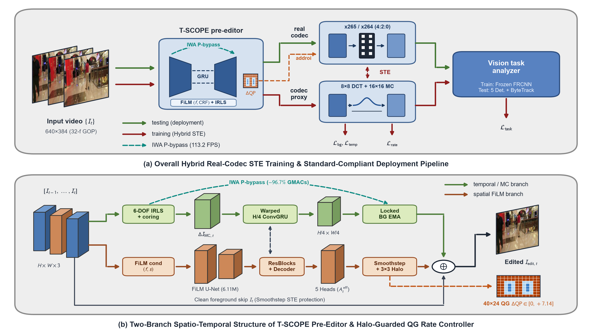
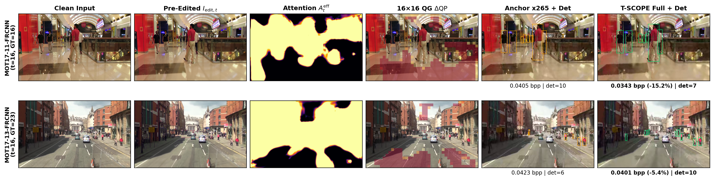

# T-SCOPE: Motion-Compensated Semantic Pre-Editing and Halo-Guarded Quantization-Group Rate Allocation for Video Coding for Machines (`x265` / `x264`)

> **Tiếng Việt:** Tiền biên tập ngữ nghĩa bù chuyển động và phân bổ lượng tử hóa cấp Nhóm Lượng Tử (QG) có viền bảo vệ cho Mã hóa Video phục vụ Thị giác Máy (`libx265` HEVC & `libx264` AVC, 100% tương thích luồng bit chuẩn 4:2:0).

- **Bản thảo bài báo (English Preprint):** [`paper/main.pdf`](./paper/main.pdf) ([`paper/main.tex`](./paper/main.tex))
- **Bản thảo bài báo (Tiếng Việt Preprint):** [`paper/main_vi.pdf`](./paper/main_vi.pdf) ([`paper/main_vi.tex`](./paper/main_vi.tex))
- **Báo cáo thực nghiệm đầy đủ (Auto-Synced JSON Single Source of Truth):** [`docs/V3_Q1_BENCHMARK_REPORT.md`](./docs/V3_Q1_BENCHMARK_REPORT.md)
- **Trọng số phát hành (5 Uniform Model Soups kiểm định trên `MOT17-09`):** [`release_ckpts/`](./release_ckpts/) & [`docs/soup_connectivity_report.json`](./docs/soup_connectivity_report.json)
- **Kiểm thử tự động:** `55 passed, 11 subtests passed` (`pytest -q`)



---

## 1. Tổng hợp những nâng cấp cốt lõi ở T-SCOPE v3

`T-SCOPE v3` chuẩn hóa toàn diện phương pháp luận, giao thức bộ mã hóa thực tế và kiểm định thống kê:

| Hạng mục kỹ thuật | Hạn chế ở phiên bản cũ (`v2`) | Chuẩn hóa ở `T-SCOPE v3` |
| :--- | :--- | :--- |
| **1. Định dạng màu (Chroma Subsampling)** | Đầu vào PNG RGB khiến `ffmpeg` chuyển ngầm sang `yuv444p`, lệch chuẩn nén thực tế. | Ép cứng `-pix_fmt yuv420p` (Main 4:2:0) trên toàn bộ phép nén `libx265` và `libx264` trong [`video_codecs/hybrid_x265_ste.py`](./video_codecs/hybrid_x265_ste.py). |
| **2. Cấu trúc GOP & Chế độ mã hóa** | Dùng `keyint=30` không tường minh `bframes`. | Chuẩn hóa `EVAL_GOP_LEN = 32`, tách bạch **Low-Delay P (`bframes = 0`)** và **Random Access (`IBBP`, `bframes = 4`)** với đếm byte thực theo PTS qua `ffprobe`. |
| **3. Đa họ Codec (`SeverityConditioner`)** | Chỉ cố định 1 họ codec (`libx265`). | Huấn luyện chung 2 họ codec (`family_id=0`: **HEVC/`libx265`**, `family_id=1`: **H.264/`libx264`**) và kiểm chứng chéo trực tiếp. |
| **4. Tỉ lệ khung hình & Dải làm việc CRF** | Resize vuông `512×512` làm méo ngang đối tượng; `CRF ∈ {22..37}` bão hòa ở đầu cao. | Giữ tỉ lệ `16:9` chuẩn **`640×384` (`IMG_H=384, IMG_W=640`)** và dải chuẩn VCM **`CRF ∈ {27, 32, 37, 42}`**. |
| **5. Lưới `addroi` QG nguyên bản & Halo Guard** | Hạ mẫu bản đồ chú ý xuống `16×16` ô làm rò `+$ΔQP` vào biên người đi bộ. | Giữ nguyên lưới Quantization Group `16×16 px` (**`40×24 = 960` ô QG** tại `640×384`) kèm bộ lọc cực đại **`3×3` Foreground Halo Guard** và tự động offload `filter_script` khi vượt `4,000` ký tự. |
| **6. Đường tắt P-frame thực sự (`iwa_gop_qp_reuse`)** | Vẫn chạy U-Net trên mọi frame rồi mới trộn đầu ra (`0%` giảm FLOPs). | Cài đặt `forward_inter_bypass_step()` trong [`models/temporal_scope.py`](./models/temporal_scope.py): chỉ chạy U-Net/ConvGRU tại I-frame (`t mod 32 = 0`), 31 P-frame đi qua nhánh nhẹ `inter_refine` (`1,604` tham số), **giảm `96.78%` GMACs/frame** (`137.71 -> 4.43 GMACs`) và đạt **`113.21 FPS` (`20.4×`)** trên Tesla T4. |
| **7. Ổn định số học FP16/AMP** | `torch.logit` dưới `float16` dễ tràn `+inf`/`NaN`. | Tính toán nhánh trộn logit & IRLS ở `FP32` (`autocast(enabled=False)`), kẹp an toàn trước `BCE` trong [`losses/vcm_temporal_loss.py`](./losses/vcm_temporal_loss.py). |
| **8. Chống rò rỉ Detector (Single-Teacher)** | Dùng nhiều detector lúc huấn luyện làm mất tính khách quan zero-shot. | **Chỉ huấn luyện với duy nhất 1 giáo viên đóng băng (`Faster R-CNN ResNet50-FPN v2`, `use_yolov8s = False`)**; toàn bộ `YOLOv8s`, `RetinaNet`, `FCOS`, `SSDLite`, `Swin-T` hoàn toàn ẩn lúc train. |
| **9. Công bằng hóa Ablation & Cân bằng Shard** | Khác biệt cấu hình STE và số shard giữa các biến thể. | Cân bằng **`3 shards × 5 variants = 15 shards`** (`seed=2026`), bật công bằng `real_x265_ste=True` cho cả 4 biến thể chính và tách riêng `wo_x265_ste_proxy`. |
| **10. Thống kê PCHIP BDBR & Kiểm định bác bỏ** | Đa thức bậc 3 dễ dao động Runge; thiếu khoảng tin cậy. | Nội suy đơn điệu từng khúc **`scipy.interpolate.PchipInterpolator`** (`JCTVC-E137`), tách **Total BDBR** và **Inter/P-Frame BDBR**, kèm **`10,000` lần paired clip-bootstrap 95% CI** và **5 cổng kiểm định bác bỏ `C01–C05`**. |

---

## 2. Đối chiếu với các công trình VCM tiêu biểu

| # | Công trình | Cơ chế chính | Điểm nghẽn mà T-SCOPE giải quyết |
| :--- | :--- | :--- | :--- |
| **1** | **Zhao et al.** *(DCC 2024, `arXiv:2512.15331`)* | Tiền xử lý 2 nhánh (2D + 3D Conv) trước `x264`/`x265`, chỉ huấn luyện qua Virtual Codec với MSE toàn khung. | MSE toàn khung ép giữ chi tiết nền thừa; chỉ học qua codec ảo nên lệch phân phối lượng tử `aq-mode=2` và `yuv420p` của `x265`/`x264` thật. |
| **2** | **SCOPE** *(Dani et al., 2026 — `miccunifi/SCOPE`)* | FiLM U-Net hai nhánh cho ảnh tĩnh, trộn bảo toàn vật thể và làm mờ nền qua mặt nạ `A`. | Lọc độc lập từng frame gây nhấp nháy phần dư liên khung trên GOP 32 frame (`+2.11%` BDBR trên `MOT17`) và bỏ phí mặt nạ `A` trước bước RDO của codec. |
| **3** | **TSW-Pre** *(Yang et al., IEEE TCSVT 2024)* | U-Net điều biến ngữ nghĩa theo tác vụ (SFT). | Đòi hỏi chạy mạng detector nặng ngay tại phía bộ mã hóa ở mọi khung hình. |
| **4** | **Lu et al.** *(IEEE TCSVT 2024)* | Hybrid Forward-BPG / Backward-Proxy với lớp QAL. | Chỉ thiết kế cho ảnh tĩnh Intra, không giải quyết bù chuyển động toàn cục hay điều khiển QG trên chuỗi P/B-frame. |
| **5** | **WA-RDO / IWA-RDO** *(Fernández-Menduiña et al., ICASSP 2026)* | Tái sử dụng bản đồ trọng số I-frame cho GOP trong mã hóa đặc trưng. | T-SCOPE đưa phân bổ không âm có viền bảo vệ `3×3` xuống lưới QG `16×16` của `x265`/`x264` và bổ sung bù chuyển động `6-DOF Cauchy-IRLS` (`741.84 FPS`) cho đường tắt P-frame. |

---

## 3. Kiến trúc và Cơ chế T-SCOPE (`6,108,814` tham số)

### 3.1. Điều kiện hóa đa họ codec và mức độ nén (`SeverityConditioner`)
- Nhúng rời rạc họ bộ mã hóa `f ∈ {0: libx265, 1: libx264}` (8 chiều, cập nhật luân phiên 50/50 mỗi batch) ghép với khai triển đa thức–bản lề 6 chiều của mức nén `s = clip((CRF - 22) / 25, 0, 1)`, sinh vector điều biến FiLM `c ∈ R^64`.

### 3.2. Nhánh thời gian: 6-DOF Cauchy-IRLS, Khóa tĩnh, Khử nhiễu hạt & Đường tắt IWA
- **6-DOF Cauchy-IRLS (`estimate_global_affine_irls`):** Tìm dịch chuyển thô tại `H/8` và tinh chỉnh Gauss–Newton trọng số Cauchy (`δ = 0.04`) hai tầng `H/8 -> H/4` ở `FP32`, kèm **khóa tĩnh `< 0.75 px`** (tránh làm mờ chuỗi camera tĩnh) và **khử nhiễu hạt cảm biến mềm** (`τ_core = 0.012`).
- **Motion-Warped `H/4` ConvGRU & Locked BG EMA:** Căn chỉnh trạng thái ẩn và khóa trung bình trượt mũ vùng nền tĩnh theo độ tin cậy chuyển động, giữ khối nền vào chế độ `SKIP`/`MERGE` trên chuỗi P-frame dài.
- **Chế độ `iwa_gop_qp_reuse`:** Chỉ chạy U-Net + ConvGRU ở I-frame (`t mod 32 = 0`), còn 31 P-frame chạy nhánh tinh chỉnh nhẹ `inter_refine` tại `H/2`, tiết kiệm **`96.72%` GMACs lý thuyết** (`96.78%` đo thực nghiệm) và đạt **`113.21 FPS`**.

### 3.3. Nhánh không gian & Phân bổ QG `40×24` có viền bảo vệ `3×3` (`compute_ctu_qp_offsets`)
- Mặt nạ tiền cảnh hiệu dụng `A_eff` (Smoothstep STE bảo vệ đối tượng khỏi rò rỉ làm mờ) đi qua bộ lọc cực đại **`3×3` Foreground Halo Guard** trước khi gom về lưới Quantization Group `16×16 px` (`40×24` ô tại `640×384`):
  - `A_QG = 0.50 * AvgPool_16(A_guard) + 0.50 * MaxPool_16(A_guard)`.
  - Bất kỳ pixel tiền cảnh nào `>= 0.76` sẽ đẩy `A_QG >= 0.38 = τ`, khóa cứng `ΔQP_fg = 0.0`.
  - Vùng nền (`A_QG < 0.38`) nhận độ lệch lượng tử không âm **`ΔQP ∈ [0.0, +7.14]`** (`qoffset = ΔQP / 51 ∈ [0.00, +0.14]`) kèm kế thừa đơn điệu an toàn qua các P-frame.

### 3.4. Huấn luyện Hybrid Real-Codec STE một giáo viên duy nhất
- Lượt tiến gọi trực tiếp `libx265` / `libx264` chuẩn `yuv420p`; lượt truyền ngược truyền gradient qua proxy khả vi `8×8 DCT + 16×16 MC` khớp họ codec và lưới QG.
- Giám sát duy nhất bằng `Faster R-CNN ResNet50-FPN v2` đóng băng (`{P2, P3, P4, P5}`).

---

## 4. Kết quả Thực nghiệm Chuẩn Hóa

<!-- BEGIN_V3_BENCHMARKS -->
## 5. Verified T-SCOPE v3 Q1 Benchmark Summary (Auto-Synced via `scripts/sync_paper_tables.py`)

Source manifest SHA-256: `15fbc3d5438657b2388db742fe6e3fdf63c98b62d3cccefde90618344aa139f5` (`schema_version = 3`, `640x384` 16:9, `yuv420p`, `GOP = 32`, `CRFS = [27, 32, 37, 42]`, `PchipInterpolator` + `10,000` paired clip-bootstrap 95% CIs). Full disaggregation in [`docs/V3_Q1_BENCHMARK_REPORT.md`](./docs/V3_Q1_BENCHMARK_REPORT.md).

| Variant / Method | Total BDBR (`FRCNN AP@50` + 95% CI) | Inter/P-Frame BDBR (`FRCNN AP@50`) | Total BDBR (`FRCNN AP@50:95`) | Zero-Shot `YOLOv8s AP@50` BDBR |
| :--- | :---: | :---: | :---: | :---: |
| `anchor_x265` | +0.00% (`[+0.00, +0.00]`) | +0.00% | +0.00% | +0.00% |
| `deterministic_blur_ema` | +44.26% (`[+31.93, +56.55]`) | +48.82% | +38.94% | +53.60% |
| `spatial_only_scope` | -9.80% (`[-14.91, -5.94]`) | -9.74% | -9.56% | -15.73% |
| `wo_x265_ste_proxy` | -6.03% (`[-11.83, -1.67]`) | -5.47% | -7.66% | -9.49% |
| `wo_ctu_delta_qp` | -6.24% (`[-13.00, -2.04]`) | -5.76% | -5.77% | -15.10% |
| `iwa_gop_qp_reuse` (`-96.7%` GMACs) | -11.92% (`[-18.91, -6.00]`) | -11.38% | -8.24% | -17.49% |
| **`full_tscope` (Ours)** | **-8.87%** (`[-13.45, -4.38]`) | -8.40% | -10.09% | -21.87% |
| `oracle_gt_mask_upper_bound` (GT) | -10.19% (`[-23.61, +4.91]`) | -7.56% | -17.65% | +12.34% |

- **Cross-Codec & Random Access:** `libx264` (`family_id=1`) FRCNN AP@50 BDBR = -15.57% | HEVC Random Access (`IBBP`, `bframes=4`) FRCNN AP@50 BDBR = -14.49%.
- **ByteTrack Multi-Object Tracking BDBR:** `MOTA` = +15.53%, `IDF1` = -0.71%, `HOTA` = -2.22%.
<!-- END_V3_BENCHMARKS -->

### 5.1. Đối chứng SOTA ngoại vi trên `MOT17` (`1,632` frames, `51` GOPs 32 khung, `yuv420p`)

| Phương pháp | Nhóm tiếp cận | Tot BDBR `FRCNN AP@50` (95% CI) | P-BDBR `FRCNN AP@50` | Tot BDBR `FRCNN AP@50:95` | Zero-Shot `YOLOv8s AP@50` |
| :--- | :--- | :---: | :---: | :---: | :---: |
| `Direct libx265 Anchor` | Chuẩn HEVC 4:2:0 | `+0.00%` | `+0.00%` | `+0.00%` | `+0.00%` |
| `Compressed-Domain FT FRCNN` | Tinh chỉnh Detector | `+83.12%` (`[+49.0, +111.2]`) | `+88.81%` | `+84.02%` | `--` |
| `Deterministic Blur + EMA` | Lọc mờ không học | `+44.26%` (`[+31.9, +56.6]`) | `+48.82%` | `+38.94%` | `+53.60%` |
| `MPEG-VCM Spatial Resampling` | Co giãn phân giải CTC | `+19.67%` (`[+8.2, +30.7]`) | `+22.39%` | `+2.38%` | `+5.44%` |
| `Official SCOPE` (`miccunifi/SCOPE`) | SOTA tiền xử lý ảnh tĩnh | `+2.11%` (`[-6.3, +8.5]`) | `+2.67%` | `-2.25%` | `+5.29%` |
| `Detector-ROI addroi` | Cần chạy Detector ở Encoder | `-8.91%` (`[-15.1, -3.4]`) | `-7.92%` | `-12.59%` | `-9.65%` |
| **`T-SCOPE IWA-Bypass` (`113.2 FPS`)** | **Keyframe + P-Bypass** | **`-11.92%`** (`[-18.9, -6.0]`) | **`-11.38%`** | `-8.24%` | `-17.49%` |
| **`T-SCOPE Full` (Ours)** | **MC + Halo QG P-Carry** | **`-8.87%`** (`[-13.4, -4.4]`) | **`-8.40%`** | **`-10.09%`** | **`-21.87%`** |


### 5.2. Chuyển giao Zero-Shot sang 4 Detector ẩn, Swin-T ViT, `libx264` & `HEVC Random Access`

Toàn bộ kết quả từ [`outputs_kaggle_pool/cross_backbone_bdbr.json`](./outputs_kaggle_pool/cross_backbone_bdbr.json) (cận trên 95% CI đều `< 0%` trên mọi cặp):

| Chế độ Codec & GOP | Kiến trúc Downstream | Vai trò | `Spatial-Only` (`AP@50`) | **`T-SCOPE Full` (`AP@50` + 95% CI)** | `T-SCOPE` P-BDBR | `T-SCOPE` (`AP@50:95`) | `Feat-SNR` BDBR |
| :--- | :--- | :--- | :---: | :---: | :---: | :---: | :---: |
| **HEVC LDP** (`x265`, `B=0`) | `Faster R-CNN R50-FPN v2` | Teacher | `-9.79%` | `-8.87%` (`[-13.4, -4.4]`) | `-8.40%` | **`-10.09%`** | `+0.01%` |
| **HEVC LDP** (`x265`, `B=0`) | `YOLOv8s` (CSPDarknet) | **Zero-Shot** | `-15.73%` | **`-21.87%`** (`[-27.9, -15.7]`) | `-22.08%` | **`-16.30%`** | `-4.56%` |
| **HEVC LDP** (`x265`, `B=0`) | `RetinaNet R50-FPN v2` | **Zero-Shot** | `-8.78%` | **`-9.40%`** (`[-12.9, -5.5]`) | `-8.96%` | **`-8.85%`** | `+1.76%` |
| **HEVC LDP** (`x265`, `B=0`) | `FCOS R50-FPN` | **Zero-Shot** | `-14.41%` | **`-14.74%`** (`[-18.2, -10.2]`) | `-14.60%` | **`-13.85%`** | `+4.29%` |
| **HEVC LDP** (`x265`, `B=0`) | `SSDLite MobileNetV3` | **Zero-Shot** | `-12.29%` | **`-14.05%`** (`[-26.8, -0.5]`) | `-13.86%` | **`-13.95%`** | `+18.50%` |
| **HEVC LDP** (`x265`, `B=0`) | `Swin-T ViT` | **Zero-Shot Feat** | `--` | `--` | `--` | `--` | **`-5.02%`** |
| **AVC LDP** (`libx264`, `f=1`) | `Faster R-CNN R50-FPN v2` | In-Domain | `-9.04%` | **`-15.57%`** (`[-18.7, -10.6]`) | `-15.51%` | **`-13.91%`** | `-1.98%` |
| **AVC LDP** (`libx264`, `f=1`) | `YOLOv8s` | **Zero-Shot** | `-13.03%` | **`-13.48%`** (`[-17.6, -10.2]`) | `-13.36%` | **`-12.73%`** | `-5.48%` |
| **AVC LDP** (`libx264`, `f=1`) | `RetinaNet R50-FPN v2` | **Zero-Shot** | `-9.56%` | **`-13.91%`** (`[-16.6, -11.0]`) | `-13.78%` | **`-13.41%`** | `-2.40%` |
| **HEVC RA** (`x265 IBBP`, `B=4`) | `Faster R-CNN R50-FPN v2` | In-Domain | `-15.22%` | `-14.49%` (`[-19.9, -9.9]`) | `-13.90%` | `-11.02%` | `-0.48%` |
| **HEVC RA** (`x265 IBBP`, `B=4`) | `YOLOv8s` | **Zero-Shot** | `-19.71%` | **`-21.47%`** (`[-26.2, -12.9]`) | `-21.40%` | **`-17.29%`** | `-5.38%` |
| **HEVC RA** (`x265 IBBP`, `B=4`) | `RetinaNet R50-FPN v2` | **Zero-Shot** | `-11.33%` | `-10.74%` (`[-14.6, -6.1]`) | `-9.85%` | `-11.41%` | `-1.83%` |

### 5.3. Theo dõi đa đối tượng (`ByteTrack`) & Đa tập dữ liệu (`MOT20`, `KITTI`)

| Phương pháp | `MOTA` BDBR | `IDF1` BDBR | `HOTA` BDBR | Zero-Shot `MOT20` (`mAP@50` BDBR) | Zero-Shot `KITTI` 4 lớp (`mAP@50` BDBR) |
| :--- | :---: | :---: | :---: | :---: | :---: |
| `Direct libx265 Anchor` | `+0.00%` | `+0.00%` | `+0.00%` | `+0.00%` | `+0.00%` |
| `T-SCOPE Spatial-Only` | `+26.63%` *(suy giảm)* | `+6.68%` *(suy giảm)* | `+5.76%` *(suy giảm)* | `-19.62%` | `-13.55%` |
| **`T-SCOPE IWA-Bypass` (`K=32`)** | **`+0.75%`** | **`-0.16%`** | **`-3.22%`** | `-5.39%` | **`-8.70%`** |
| **`T-SCOPE Full` (Ours)** | `+15.53%` | **`-0.71%`** | **`-2.22%`** | **`-12.72%`** | **`-8.40%`** |

### 5.4. Trực quan hóa Định tính trên `MOT17-11` và `MOT17-13` (`CRF = 37`)



---

## 6. Kiểm định Linear Mode Connectivity & Hiệu năng phần cứng Tesla T4

### 6.1. Kiểm định Model Soup trên tập Validation `MOT17-09` ([`docs/soup_connectivity_report.json`](./docs/soup_connectivity_report.json))

| Biến thể (`release_ckpts/tscope_soup_<variant>.pt`) | Uniform Soup Loss | Trung bình ± Độ lệch chuẩn 3 Shard lẻ | Greedy Soup Loss (Shard chọn) | Liên thông tuyến tính (`Uniform <= Mean`) |
| :--- | :---: | :---: | :---: | :---: |
| **`full_tscope`** | **`3.7816`** | `3.9308 ± 0.0876` | `3.7816` (`[10, 0, 5]`) | **Đạt (`-0.1492`)** |
| **`iwa_gop_qp_reuse`** | **`3.8312`** | `3.9621 ± 0.0683` | `3.8051` (`[8, 13]`) | **Đạt (`-0.1309`)** |
| **`wo_ctu_delta_qp`** | **`3.7605`** | `3.8211 ± 0.0145` | `3.7272` (`[11, 1]`) | **Đạt (`-0.0606`)** |
| **`wo_x265_ste_proxy`** | **`3.7010`** | `3.8383 ± 0.1087` | `3.7010` (`[4, 9, 14]`) | **Đạt (`-0.1374`)** |
| `spatial_only_scope` | `3.9920` | `3.9760 ± 0.0967` | `3.8933` (`[12]`) | `Không` |

### 6.2. Độ trễ GPU (NVIDIA Tesla T4) & Thời gian Mã hóa + Giải mã CPU thực tế (`640×384`, `GOP = 32`)

| Thành phần / Chế độ vận hành | Tham số | GMACs / Frame | Mean (`ms/f`) | P95 (`ms/f`) | Tốc độ (`FPS`) | VRAM Đỉnh / Bitrate (`CRF 32`) |
| :--- | :---: | :---: | :---: | :---: | :---: | :---: |
| Riêng khối `6-DOF Cauchy-IRLS` | `0` | `0.10` | `1.35` | `1.51` | **`741.84 FPS`** | `342.6 MB` |
| **`T-SCOPE IWA-Bypass` (`K=32`, `-96.78%` GMACs)** | **`6.109M`** | **`4.43`** | **`8.83`** | **`9.08`** | **`113.21 FPS` (`20.4×`)** | **`1325.5 MB`** |
| `T-SCOPE Spatial-Only` (`B=0` MC) | `6.109M` | `137.58` | `174.49` | `176.38` | `5.73 FPS` | `974.1 MB` |
| `T-SCOPE Full` (U-Net + MC mọi frame) | `6.109M` | `137.71` | `180.05` | `184.69` | `5.55 FPS` | `1336.8 MB` |
| `Official SCOPE` (`miccunifi/SCOPE`) | `1.879M` | `86.56` | `100.17` | `101.17` | `9.98 FPS` | `7991.9 MB` |
| CPU Encode+Decode: `libx265` Anchor | `libx265` | `--` | `66.19` | `--` | `15.11 FPS` | `0.0621 bpp` |
| CPU Encode+Decode: `T-SCOPE IWA` Static `addroi` | `libx265` | `--` | **`58.22`** | `--` | **`17.18 FPS`** | **`0.0604 bpp`** |
| CPU Encode+Decode: `T-SCOPE Full` Dynamic `addroi` | `libx265` | `--` | `61.12` | `--` | `16.36 FPS` | `0.0614 bpp` |
| CPU Encode+Decode: `libx264` Anchor | `libx264` | `--` | `50.76` | `--` | `19.70 FPS` | `0.0424 bpp` |
| CPU Encode+Decode: `T-SCOPE Full` `libx264 addroi` | `libx264` | `--` | `52.69` | `--` | `18.98 FPS` | `0.0444 bpp` |

---

## 7. Cấu trúc thư mục & Tái lập thực nghiệm

```text
├── README.md
├── paper/                              # Bản thảo bài báo IEEEtran (Tiếng Anh & Tiếng Việt)
│   ├── main.tex / main.pdf             # Bản thảo Tiếng Anh (14 trang)
│   ├── main_vi.tex / main_vi.pdf       # Bản thảo Tiếng Việt (8 trang)
│   ├── references.bib                  # Tài liệu tham khảo BibTeX
│   ├── metrics_macros.tex              # Macro số liệu sinh tự động từ JSON
│   └── tables_generated.tex            # Các bảng LaTeX sinh tự động từ JSON
├── docs/
│   ├── V3_Q1_BENCHMARK_REPORT.md       # Báo cáo chi tiết toàn bộ bảng thực nghiệm
│   ├── soup_connectivity_report.json   # Kiểm định Linear Mode Connectivity trên MOT17-09
│   └── figures/                        # Kịch bản & hình vẽ kiến trúc, BDBR, ablation, định tính
├── models/
│   ├── temporal_scope.py               # TemporalSCOPE (6.11M params), 6-DOF IRLS, IWA P-bypass, Halo QG
│   └── frozen_detector_fpn.py          # Faster R-CNN FPN teacher & đánh giá đa detector
├── video_codecs/
│   └── hybrid_x265_ste.py              # Hybrid libx265/libx264 (yuv420p, LDP/RA GOP=32) + Proxy STE
├── losses/
│   └── vcm_temporal_loss.py            # Hàm mất mát VCM Single-Teacher ổn định FP32/AMP
├── vcm_datasets/
│   └── vcm_video_datasets.py           # Bộ nạp dữ liệu MOT17, MOT20, KITTI (640×384, 16:9)
├── outputs_kaggle_pool/
│   ├── merged_benchmarks.json          # Kết quả gộp 12 shard + 10k clip-bootstrap 95% CI
│   └── cross_backbone_bdbr.json        # Kết quả gộp 3 chế độ × 6 kiến trúc Cross-Backbone/Codec
├── release_ckpts/                      # 5 Uniform Model Soups phát hành kèm SHA-256
├── scripts/                            # Điều phối Kaggle, đánh giá, vẽ hình và đồng bộ bảng tự động
└── tests/                              # 55 bài kiểm thử đơn vị bảo vệ hợp đồng toán học & dữ liệu
```

### Lệnh kiểm tra & đồng bộ nhanh

```powershell
# 1. Chạy toàn bộ bộ kiểm thử đơn vị
python -m pytest -q

# 2. Tái tạo hình vẽ kiến trúc & đường cong BDBR từ JSON thực nghiệm
python docs/figures/gen_fig_pipeline_overview.py
python scripts/gen_fig_bdbr_curves.py --benchmark outputs_kaggle_pool/merged_benchmarks.json --output-dir docs/figures

# 3. Đồng bộ tự động JSON -> LaTeX macros/tables, docs/V3_Q1_BENCHMARK_REPORT.md và README.md
python scripts/sync_paper_tables.py
```
