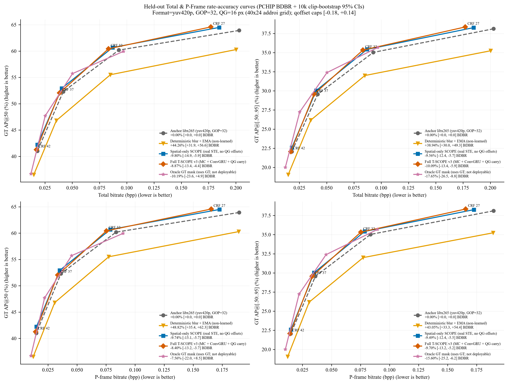
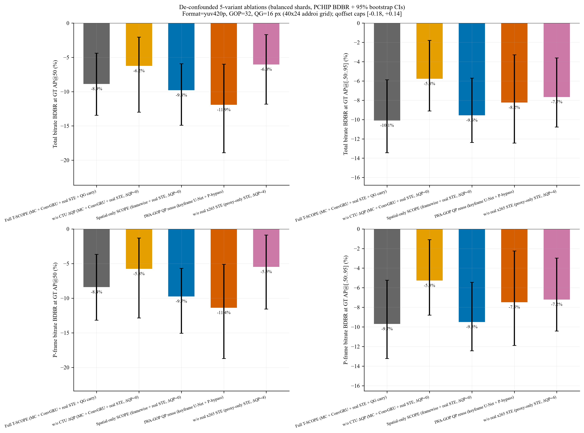

# T-SCOPE v2: Tiền xử lý Video Nhất quán Thời gian và Phân bổ Bitrate Cấp CTU cho Video Coding for Machines (`x265`)

Mã nguồn PyTorch, công thức toán học và hệ thống huấn luyện/đánh giá phân tán trên cụm 21 tài khoản Kaggle cho **T-SCOPE v2**. Kết quả toàn tập held-out (`1,648` frames, 21 shard × 5 biến thể) đặt tại [`docs/V2_BENCHMARK_REPORT.md`](./docs/V2_BENCHMARK_REPORT.md) và [`outputs_kaggle_pool/merged_benchmarks.json`](./outputs_kaggle_pool/merged_benchmarks.json).

---

## 1. Đối chiếu các hướng tiếp cận VCM trước đây

Các phương pháp tiền xử lý và tối ưu hóa Rate-Distortion cho **Video Coding for Machines (VCM)** gặp ba nút thắt khi ghép với bộ mã hóa chuẩn như **HEVC (`x265`)** và **VVC (`VVenC`)**:

| # | Paper & Venue | Cơ chế chính | Giới hạn kỹ thuật |
|---|---|---|---|
| **1** | **A Preprocessing Framework for Video Machine Vision under Compression**<br>*(Fei Zhao et al., IEEE DCC 2024 / `arXiv:2512.15331`)* | Tiền xử lý 2 nhánh (Spatial 2D + Temporal 3D Conv) trước `x264`/`x265`, huấn luyện qua Differentiable Virtual Codec (`f_q in [30, 50]`, MSE toàn khung). | 1. Phạt MSE toàn khung làm giữ lại chi tiết nền không cần thiết.<br>2. Chỉ dùng virtual codec nên lệch phân phối với `x265` thật.<br>3. Phải train riêng theo từng backbone và chưa xử lý bài toán phát hiện người dày đặc (MOT). |
| **2** | **SCOPE: Semantic COdec Pre-Editing for Object-Preserving Compression**<br>*(Silvia Dani et al., `arXiv:2610.39778`, 2026)* | Điều biến FiLM theo họ codec và mức nén `(f, s)`, tách nhánh vật thể và nhánh nền mờ qua attention `A`. | 1. Xử lý từng ảnh độc lập, dễ nhấp nháy giữa frame `t-1` và `t` khi nén chuỗi video.<br>2. Nhiễu liên khung làm tăng phần dư inter-prediction.<br>3. Chỉ dùng attention `A` để trộn pixel, không đưa xuống bộ điều khiển lượng tử của codec. |
| **3** | **TSW-Pre**<br>*(Mingyi Yang et al., IEEE TCSVT Vol. 34 No. 7, 2024)* | U-Net kết hợp Task-Attentive Semantic Modulation (SFT) và FPN distillation. | 1. Yêu cầu chạy ResNeXt-101 ngay phía encoder ở mọi lần suy luận.<br>2. Chưa thích ứng theo QP hay chuỗi video thời gian. |
| **4** | **Preprocessing Enhanced Image Compression for Machine Vision**<br>*(Guo Lu et al., IEEE TCSVT Vol. 34 No. 12, 2024 / `arXiv:2206.05650`)* | Hybrid Forward-BPG / Backward-Proxy với Quantization Adaptation Layer (QAL). | 1. Thiết kế cho nén Intra ảnh tĩnh (BPG/JPEG), chưa mô hình hóa dự đoán liên khung video.<br>2. Ràng buộc độ méo toàn khung hạn chế làm phẳng mạnh vùng nền. |
| **5** | **WA-RDO**<br>*(S. Fernández-Menduiña et al., IEEE ICASSP 2026)* | Xấp xỉ Jacobian trên miền đặc trưng; IWA-RDO dùng lại bản đồ trọng số I-frame cho toàn GOP. | 1. Áp dụng cho Feature Coding (FCM), chưa dùng cho tiền xử lý miền pixel.<br>2. Giữ nguyên bản đồ I-frame cho cả GOP dễ lệch vị trí khi vật thể hoặc camera dịch chuyển nhanh. |
| **6** | **Rate-Accuracy Bounds in Visual Coding for Machines**<br>*(Ivan V. Bajić, IEEE MIPR 2025 / `arXiv:2505.14980`)* | Thiết lập cận lý thuyết Rate-Accuracy theo mô hình DMS và Data Processing Inequality (DPI). | Bài báo lý thuyết; chỉ ra hệ thống tiền xử lý cần bỏ thông tin nền dư thừa theo cả không gian lẫn thời gian và khớp đặc trưng ở các tầng sâu FPN. |

---

## 2. Kiến trúc và Cơ chế T-SCOPE v2

**T-SCOPE v2** xử lý trực tiếp bài toán tiền biên tập video tương thích hoàn toàn với `libx265` (`ffmpeg` + `ffprobe` + `addroi`, không thay đổi bitstream chuẩn):

```text
Input Video {I_t} ──► [TemporalSCOPE (6,107,226 params / 6.11M)]
                             │  • 6-DOF Cauchy-IRLS affine MC + Static Identity Snap
                             │  • FiLM Multi-Scale U-Net (H..H/8) + H/4 ConvGRU
                             ├──► 1. Video tiền biên tập {I_edit,t}
                             │       (Smoothstep STE FG + Occlusion-Gated EMA BG)
                             └──► 2. Bản đồ attention hiệu dụng A_eff,t ──► ΔQP CTU (16x16 QG)
                                                                                 │
                                                                                 ▼
Detector (Faster R-CNN v2 / YOLOv8s) ◄── Giải mã chuẩn ◄── libx265 (addroi qoffset)
```

### 2.1. Điều kiện hóa đa họ codec và mức độ nén (`SeverityConditioner`)

Mạng nhận cặp điều kiện `(f, s)` gồm họ codec (nhúng 8 chiều) và mức độ nén chuẩn hóa `s = clip((QP - 22) / 25, 0, 1)` khai triển qua cơ sở 6 chiều `[s, s^2, s^3, h_0.50(s), h_0.75(s), h_0.90(s)]`, đi qua MLP tạo vector `c in R^64` để điều biến toàn bộ các khối FiLMConvBlock (trừ GroupNorm ở tầng full-res `H x W` nhằm giảm băng thông bộ nhớ).

### 2.2. Căn chỉnh chuyển động toàn cục 6-DOF Cauchy-IRLS và khóa nền chống nhòe

Thay cho hiệu liên khung thô ở v1 (vốn bị vỡ khi camera di chuyển nhanh trên `MOT17-13`), v2 thêm khối `estimate_global_affine_irls` chạy tìm kiếm dịch chuyển thô tại `H/8` rồi tinh chỉnh 6-DOF affine IRLS từ `H/8 -> H/4` hoàn toàn bằng `float32`:
- Static Identity Snap: nếu độ dịch 4 góc `< 0.75 px` (`flat_frame` hoặc camera tĩnh), phép biến đổi khóa về ma trận đơn vị để tránh nội suy song tuyến làm nhòe ảnh gốc.
- Căn chỉnh liên khung: warp `I_{t-1}`, trạng thái ẩn `h_{t-1}` (tại `H/4`) và nền EMA `bg_{t-1}` theo ma trận affine ước lượng kèm mặt nạ biên hợp lệ `valid_full`, `valid_h4`, đưa `diff_mc_t = (I_t - I_{prev, warped}) * valid_full` làm đầu vào.
- Bảo toàn tiền cảnh bằng Smoothstep STE (`eff_attn_t`): chuẩn hóa `u_sat = clip((A_t - 0.12) / 0.46, 0, 1)`, lấy `u_sat^2 (3 - 2 u_sat)` ở forward (truyền gradient qua nhánh proxy mượt), loại bỏ rò rỉ làm mờ nền vào vùng người đi bộ và chặn phần dư `delta_obj_t` ở mức `max_obj_res = 0.025 * sev_gate`.
- Khóa nền EMA có cổng che khuất và parallax: làm mờ nền trộn theo độ nén (`5x5` <-> đa tỷ lệ pooling), trọng số `temporal_weight = 0.85 * sigmoid(bg_temporal_gate(u1)) * conf` chỉ kích hoạt mạnh tại điểm ảnh khớp chuyển động và chưa bị che khuất (`conf = v_mask * exp(-60 * motion_mag) * clamp(1 - motion_mag / 0.05, 0, 1)`).

### 2.3. Phân bổ lượng tử hóa CTU `compute_ctu_qp_offsets` không giảm trên P-frame

Từ `eff_attn_t`, mạng hạ mẫu xuống lưới Quantization Group `qg_size = 16` (`16x16` vùng tại `512x512`) bằng tổ hợp nhạy tiền cảnh `qg_attn = 0.62 * avg_qg + 0.38 * max_qg` để giữ nguyên người đi bộ nhỏ. Với ngưỡng tuyệt đối `tau = 0.38`:
- Vùng có `qg_attn < tau` nhận tăng lượng tử hóa nền không âm `dqp_frame = clip(max_delta_qp * 1.75 * relu(tau - qg_attn) / tau, 0, 0.14 * 51)` (`max_delta_qp = 4.0`, tương ứng dải `qoffset in [-0.18, +0.14]` qua `addroi` có gộp run-length ngang).
- Ở chế độ `full_tscope`, các P-frame kế tiếp kế thừa `dQP` nền từ frame trước qua `fg_safe` (hạ mượt về `0` khi phát hiện vật thể tiền cảnh ở lưới `s`) để giữ ổn định phần dư nền trong GOP. Chế độ `iwa_gop_qp_reuse` giữ nguyên bản đồ I-frame cho cả mini-GOP 4 frame, còn `spatial_only_scope` tắt toàn bộ nhánh thời gian.

### 2.4. Hybrid `libx265` Forward / Proxy Backward & Hàm Loss Đa Detector

Trong lúc train, nhánh forward gọi `libx265` thật qua `ffmpeg`, còn nhánh backward truyền gradient qua `DifferentiableVideoProxy` (hỗ trợ cả thành phần Intra/Inter ở `H/8 + H/2` và đường cong SKIP QP). Duy nhất mạng `TemporalSCOPE` (`6,107,226` tham số) được huấn luyện với 2 detector đóng băng (`Faster R-CNN ResNet50-FPN v2` two-stage và `YOLOv8s` one-stage):
- Mất mát đặc trưng đa tỷ lệ: Smooth-L1 có mặt nạ trên `{p2, p3, p4, p5}` của Faster R-CNN và `{yolo_p3, yolo_p4, yolo_p5}` của YOLOv8s.
- Bảo toàn tiền cảnh & attention: pixel/gradient/reconstruction trên ROI người đi bộ, phạt rò rỉ làm mờ, kết hợp Tversky (`alpha=0.25, beta=0.75`) + BCE có trọng số cho `A_t`.
- Tối ưu bitrate tách riêng I/P: phạt trực tiếp `i_frame_bpp_proxy` và `p_frame_bpp_proxy` (gồm hạng tử `log1p`), kèm mất mát nhất quán nền đã bù chuyển động `L_temp_bg` có trọng số che khuất và phạt giảm/rò rỉ `dQP`.

---

## 3. Cấu trúc mã nguồn

```text
├── README.md
├── TCSVT_Paper_Blueprint.md
├── docs/
│   ├── V2_BENCHMARK_REPORT.md        # Báo cáo đầy đủ T-SCOPE v2 (1,648 frames, 105 shard-variants)
│   └── figures/                      # Biểu đồ rate-accuracy 1x2, ablation BDBR và ảnh kiểm tra pre-edit
├── models/
│   └── temporal_scope.py             # Mạng TemporalSCOPE (6,107,226 params), Cauchy-IRLS MC, ConvGRU, CTU dQP
├── video_codecs/
│   └── hybrid_x265_ste.py            # libx265 real forward + DifferentiableVideoProxy & motion estimation
├── losses/
│   └── vcm_temporal_loss.py          # VCMTemporalPreEditLoss (FPN + YOLO, FG pix/grad, I/P BPP, dQP mono)
├── vcm_datasets/
│   └── vcm_video_datasets.py         # Nạp chuỗi MOT17 thật, ground truth và tách split train/val/test
├── scripts/
│   ├── prepare_kaggle_datasets.py    # Chuẩn bị dataset MOT17 trên Kaggle
│   ├── kaggle_shard_runner.py        # Train / eval_soup trên từng shard kèm cosine LR + early stopping
│   ├── validate_soups.py             # Thẩm định cục bộ 5 model soup trên toàn tập MOT17-09
│   ├── merge_shards.py               # Tạo model soup và tổng hợp schema-v2 BDBR (merged_benchmarks.json)
│   ├── kaggle_pool_orchestrator.py   # Điều phối 21 tài khoản Kaggle
│   ├── gen_fig_bdbr_curves.py        # Sinh biểu đồ rate-accuracy và ablation BDBR (1x2 Total bpp)
│   └── generate_ablation_visuals.py  # Sinh lưới ảnh pre-edit và diff so sánh trên MOT17
├── release_ckpts/                    # 5 Model Soup đã kiểm định trên MOT17-09
├── outputs_kaggle_pool/
│   └── merged_benchmarks.json        # Benchmark cuối cùng (schema_version=2, final_ready=true)
└── train_and_verify.py               # Kiểm tra nhanh pipeline forward/backward
```

---

## 4. Vận hành cụm 21 tài khoản Kaggle

Chạy tuần tự từ local thông qua `scripts/kaggle_pool_orchestrator.py` và file token pool:

```powershell
# 1. Xác thực pool
python -I scripts/kaggle_pool_orchestrator.py --pool_file "<path/to/pool.json>" --action verify_pool

# 2. Huấn luyện 21 shard song song ở 512x512 (Faster R-CNN + YOLOv8s)
python -I scripts/kaggle_pool_orchestrator.py --pool_file "<path/to/pool.json>" --action push --run_mode train --ablation_sweep --img_size 512 --batch_size 2 --grad_accum_steps 2 --epochs 36 --patience 10 --min_epochs 12 --lr 1.5e-4 --min_gpu_hours 8.5 --skip_exhausted --use_yolov8s

# 3. Kéo checkpoint về và gộp Model Soup theo variant
python -I scripts/kaggle_pool_orchestrator.py --pool_file "<path/to/pool.json>" --action pull --output_dir ./outputs_kaggle_pool
python -I scripts/merge_shards.py --action soup --manifest "<collection_manifest.json>" --ckpt_dir "<soup_dir>"

# 4. Kiểm định soup trên MOT17-09, đẩy release_ckpts/*.pt rồi đánh giá chéo 21 shard
python -I scripts/validate_soups.py --soup-dir "<soup_dir>" --output-dir "<validated_dir>" --data-root "<mot17_09_root>"
python -I scripts/kaggle_pool_orchestrator.py --pool_file "<path/to/pool.json>" --action push --run_mode eval_soup --ablation_sweep --img_size 512

# 5. Tổng hợp benchmark cuối và vẽ biểu đồ
python -I scripts/merge_shards.py --action eval --manifest "<eval_collection_manifest.json>" --eval_dir ./outputs_kaggle_pool/eval_v2_final --ckpt_dir ./release_ckpts
python -I scripts/gen_fig_bdbr_curves.py --benchmark outputs_kaggle_pool/merged_benchmarks.json --output-dir docs/figures
```

---

## 5. Kết quả thực nghiệm T-SCOPE v2 (`1,648` frames held-out)

Toàn bộ kết quả bên dưới lấy từ [`outputs_kaggle_pool/merged_benchmarks.json`](./outputs_kaggle_pool/merged_benchmarks.json) (`schema_version = 2`, `eligibility.final_ready = true`, `complete_shard_variants = 105`, `source_manifest_sha256: 1c240c09ba4ae6970e4d347d3774d902e589e28ef1615562a97980a420fa8866`). Bộ dữ liệu held-out gồm `MOT17-11` (`900` frames) và `MOT17-13` (`748` frames, loại 2 frame cuối `749..750`), nén ở `512×512` với `libx265 -preset medium` tại `CRF ∈ {22, 27, 32, 37}`, `qg_size = 16`, lưới `addroi` tối đa `16×16` và `qoffset ∈ [-0.18, +0.14]`.

### 5.1. So sánh tổng thể trên 1,648 frame (`overall_methods_summary`)



*(Số âm = tiết kiệm bitrate ở cùng AP; số dương = tốn thêm bitrate)*

| Phương pháp | Total BDBR (`FRCNN AP@50`) | Total BDBR (`FRCNN AP@[.50:.95]`) | Total BDBR (`YOLO AP@50`) | Total BDBR (`YOLO AP@[.50:.95]`) | Total BPP (`CRF 22 / 27 / 32 / 37`) |
| :--- | :---: | :---: | :---: | :---: | :---: |
| `anchor_x265` (Trực tiếp `libx265`) | `0.00%` | `0.00%` | `0.00%` | `0.00%` | `0.6606 / 0.3352 / 0.1662 / 0.0795` |
| `deterministic_blur_ema` (Không học) | `+33.87%` | `+36.18%` | `+27.52%` | `+34.82%` | `0.6477 / 0.3157 / 0.1485 / 0.0682` |
| `spatial_scope_framewise` (Độc lập từng frame) | `-8.76%` | `-6.80%` | `-11.78%` | `-9.01%` | `0.5735 / 0.2982 / 0.1512 / 0.0740` |
| **`tscope_temporal_ctu_qp` (`full_tscope`)** | **`-19.15%`** | **`-16.32%`** | **`-16.90%`** | **`-12.59%`** | `0.5313 / 0.2765 / 0.1398 / 0.0681` |
| `oracle_gt_mask_upper_bound` (Dùng GT) | `-43.82%` | `-44.92%` | `-37.04%` | `-41.82%` | `0.2996 / 0.1627 / 0.0850 / 0.0434` |

### 5.2. Ablation 5 biến thể Model Soup (`ablation_variants_summary`)



| Variant (`tscope_soup_<variant>.pt`) | MOT17-09 Val Loss | Total BDBR (`FRCNN AP@50`) | Total BDBR (`FRCNN AP@[.50:.95]`) | Total BDBR (`YOLO AP@50`) | Total BDBR (`YOLO AP@[.50:.95]`) | `FRCNN AP@50` (`CRF 22 / 27 / 32 / 37`) |
| :--- | :---: | :---: | :---: | :---: | :---: | :---: |
| **`full_tscope`** *(Cauchy-IRLS MC + ConvGRU + STE + QG P-carry)* | `4.271654` | **`-19.15%`** | **`-16.32%`** | `-16.90%` | `-12.59%` | **`56.80% / 54.70% / 49.93% / 40.22%`** |
| `iwa_gop_qp_reuse` *(Tái sử dụng QG I-frame cho GOP)* | `4.281704` | `-18.01%` | `-10.68%` | **`-18.81%`** | **`-13.10%`** | `56.84% / 54.23% / 49.32% / 39.65%` |
| `wo_ctu_delta_qp` *(T-SCOPE không dùng QG offset)* | `4.196459` | `-11.24%` | `-12.04%` | `-11.80%` | `-7.63%` | `56.84% / 54.13% / 49.61% / 39.68%` |
| `spatial_only_scope` *(Độc lập từng frame)* | `2.883651` | `-8.76%` | `-6.80%` | `-11.78%` | `-9.01%` | `56.83% / 54.64% / 49.22% / 39.79%` |
| `proxy_only_zhao` *(Chỉ train qua proxy)* | `2.653610` | `-7.63%` | `-7.07%` | `-7.10%` | `-5.56%` | `56.63% / 54.27% / 49.44% / 39.86%` |


### 5.3. Thay đổi chính từ v1 lên v2

- Khắc phục chuỗi camera di chuyển nhanh `MOT17-13`: `full_tscope` tăng từ `-4.07%` (FR50) / `-0.22%` (FR50:95) ở v1 lên **`-16.34%` (FR50) / `-16.22%` (FR50:95)**, vượt `spatial_only_scope` (`-5.40% / -5.49%`) gần 11 điểm phần trăm.
- Bảo toàn tiền cảnh và điểm làm việc theo CRF: `ROI PSNR` ở CRF 22 tăng từ `28.33 dB` (v1) lên **`31.79 dB`** (v2, `+3.46 dB`), đồng thời `FRCNN AP@50` của `full_tscope` (`56.80% / 54.70% / 49.93% / 40.22%`) cao hơn hoặc bằng `anchor_x265` (`56.39% / 53.93% / 49.33% / 39.45%`) trên cả 4 mức CRF trong khi tiết kiệm `14.3%` đến `19.6%` tổng bpp.
- Chưa có số đo FPS/VRAM sau nâng cấp: bảng complexity/FPS của bản v1 `3.80M` và profiling cũ trước commit `b83cbbd` đã được gỡ bỏ; hiệu năng suy luận cho cấu hình v2 `6,107,226` tham số sẽ được đo tách riêng sau khi hoàn tất phần định lượng.

Chi tiết đường cong từng CRF, từng chuỗi `MOT17-11` / `MOT17-13`, hash trọng số soup và phân tích điểm còn hạn chế nằm tại [`docs/V2_BENCHMARK_REPORT.md`](./docs/V2_BENCHMARK_REPORT.md).
