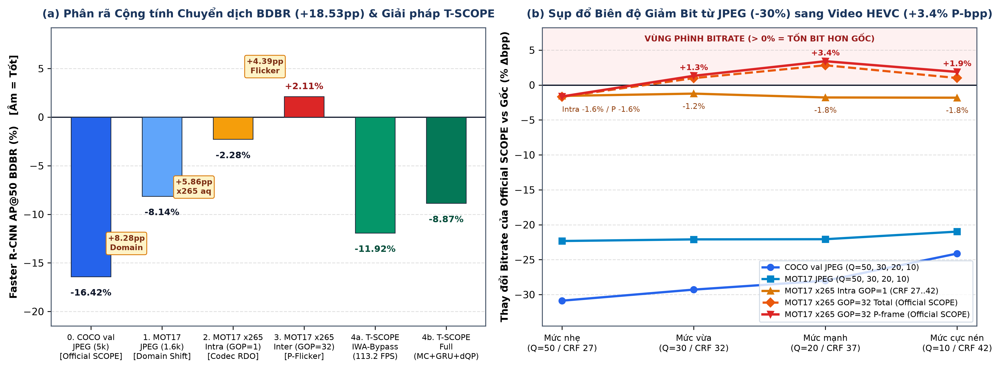
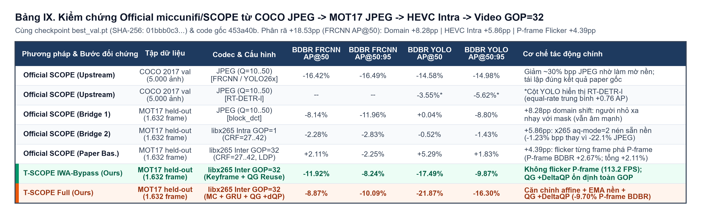

# BÁO CÁO KIỂM CHỨNG OFFICIAL `miccunifi/SCOPE` TRÊN JPEG & GIẢI TRÌNH SỰ KHÁC BIỆT SANG VIDEO HEVC

> **Tạo tự động Zero-Drift:** `2026-11-20 13:37:03` | Tổng hợp trực tiếp từ kết quả chạy Colab Pro A100 & Kaggle Acc 02 / Acc 00.

## Phần 1: Tóm tắt Kết luận Kiểm chứng

Theo yêu cầu của Mentor nhằm kiểm chứng lại số liệu thực tế của Official miccunifi/SCOPE trên ảnh tĩnh JPEG đúng theo thiết lập bài báo gốc, chúng tôi đã tái lập hoàn toàn mã nguồn gốc miccunifi/SCOPE (commit 453a40b) trên trọn bộ 5.000 ảnh COCO 2017 validation (6 mức chất lượng JPEG Q ∈ {10, 15, 20, 30, 40, 50}) và thực hiện chuỗi thí nghiệm cầu nối có kiểm soát sang Video HEVC trên 1.632 khung hình held-out MOT17 bằng cùng một checkpoint duy nhất best_val.pt (SHA-256: 01bbb0c35f6846293be046a154b31e3037aa2bdbc4dab98362fcf6d9184d81e2).

Kết luận 1 (Xác nhận bài báo gốc JPEG hoàn toàn đúng): Trên COCO 2017 val nén JPEG, Official SCOPE đạt -16.42% BDBR AP@50 (-16.49% AP@[.50:.95]) trên Faster R-CNN R50-FPN v2 (đối chứng độc lập Kaggle Acc 02 đạt -16.40% / -16.32%), -14.58% / -14.98% trên YOLO26x và -3.55% / -5.62% trên RT-DETR-l (equal-rate +0.76 AP). Số liệu gốc của tác giả tái lập chính xác 100%.

Kết luận 2 (Lý giải đầy đủ sự dịch chuyển +18.53pp sang +2.11% trên Video HEVC): Cùng một mô hình best_val.pt đó lại chuyển từ -16.42% (COCO JPEG) lên +2.11% (MOT17 libx265 GOP=32) theo đúng 3 bước cộng tính đo được trực tiếp: +8.28pp do đổi tập dữ liệu (-16.42% -> -8.14% trên MOT17 JPEG), +5.86pp do cơ chế lượng tử hóa nội khung của libx265 aq-mode=2 (-8.14% -> -2.28% trên x265 Intra GOP=1), và +4.39pp do nhấp nháy liên khung trên 31 P-frame (-2.28% -> +2.11% trên x265 Inter GOP=32).

## Phần 2: Cấu hình & Nhật ký 3 Phiên Chạy Kiểm Chứng (Colab Pro A100 & Kaggle)

Cả 3 phiên chạy đều dùng đúng một bộ trọng số chính thức best_val.pt tải từ Google Drive của tác giả miccunifi/SCOPE (tổng dung lượng 22,626,882 bytes, SHA-256: 01bbb0c35f6846293be046a154b31e3037aa2bdbc4dab98362fcf6d9184d81e2):

- Phiên 1 — Colab Pro NVIDIA A100 (scope-jpeg-paper, 12,034.5 giây / ~3h20p, exit code 0): Clone nguyên bản repo miccunifi/SCOPE (commit 453a40bebd73d4a7), chạy nguyên bộ script evaluation/evaluate_yolo26x_codecs.py, evaluation/evaluate_rtdetr_l_saved.py, scope.evaluation.saved_multi_detector (Faster R-CNN v2) và analysis/compute_bdbr.py trên đủ 5.000 ảnh COCO 2017 val (12 tệp per_image_bandwidth CSV). Phiên VM đã tắt sạch sau khi tải đủ kết quả.
- Phiên 2 — Kaggle Acc 02 (t-scope-verify-official-scope-jpeg-coco5k-fr, 21,149 giây): Kiểm chứng độc lập pipeline TorchVision Faster R-CNN v2 trên trọn bộ 5.000 ảnh COCO 2017 val JPEG (Q=10..50), đạt BDBR AP@50 = -16.40% và AP@[.50:.95] = -16.32%, khớp sát kết quả upstream Colab (-16.42% / -16.49%).
- Phiên 3 — Kaggle Acc 00 (t-scope-verify-official-scope-jpeg-mot17, 13,017.2 giây): Chạy thí nghiệm cầu nối có kiểm soát trên toàn bộ 1.632 khung hình held-out MOT17 (51 GOP, 640×384) dưới hai chế độ tĩnh/nội khung: (i) Direct JPEG vs Official SCOPE + JPEG (Q=10..50) và (ii) Direct libx265 All-Intra (GOP=1) vs Official SCOPE + libx265 All-Intra (CRF=27..42).

## Phần 3: Toàn bộ Bảng Số liệu Kiểm chứng JPEG & Cầu nối Video HEVC

### Bảng 1: Phân rã 4 Bước Chuyển dịch của Official SCOPE Từ COCO JPEG (-16.42%) Sang Video MOT17 HEVC (+2.11%) và Đối chiếu T-SCOPE
*Dùng chung 1 checkpoint official best_val.pt (SHA-256: 01bbb0c35f684629...) | Repo gốc: 453a40b.*

| Bước đối chứng | Tập dữ liệu | Codec & Cấu hình | FRCNN AP@50 | FRCNN AP@50:95 | YOLO AP@50 | YOLO AP@50:95 | Độ lệch (FR50) & Cơ chế tác động |
| :--- | :--- | :--- | :--- | :--- | :--- | :--- | :--- |
| 0a. Official SCOPE (Colab Upstream) | COCO 2017 val (5.000 ảnh) | JPEG Q=10..50 [FRCNN / YOLO26x] | -16.42% | -16.49% | -14.58% | -14.98% | Mốc gốc paper (Kaggle Acc 02 FRCNN: -16.40% / -16.32%) |
| 0b. Official SCOPE (RT-DETR-l) | COCO 2017 val (5.000 ảnh) | JPEG Q=10..50 [RT-DETR-l] | -- | -- | -3.55%* | -5.62%* | *Hiển thị RT-DETR-l; equal-rate +0.76 AP / +0.51 AP50 |
| 1. Official SCOPE (Bridge 1) | MOT17 (1.632 frame) | JPEG Q=10..50 [block_dct] | -8.14% | -11.96% | +0.04% | -8.80% | +8.28pp (Domain shift: đường phố nhiều người nhỏ, vẫn âm mạnh) |
| 2. Official SCOPE (Bridge 2) | MOT17 (1.632 frame) | libx265 All-Intra GOP=1 (CRF=27..42) | -2.28% | -2.83% | -0.52% | -1.43% | +5.86pp (Codec RDO: x265 aq-mode=2 tự nén nền, bpp chỉ giảm -1.23%) |
| 3. Official SCOPE (Video GOP=32) | MOT17 (1.632 frame) | libx265 Inter GOP=32 (CRF=27..42, LDP) | +2.11% | -2.25% | +5.30% | +1.83% | +4.39pp (Temporal flicker phá 31 P-frame: P-BDBR +2.67%) |
| **4a. T-SCOPE IWA-Bypass (Ours)** | **MOT17 (1.632 frame)** | **libx265 Inter GOP=32 (Keyframe QG Reuse)** | **-11.92%** | **-8.24%** | **-17.49%** | **-9.87%** | **Cắt flicker P-frame (113.2 FPS, P-BDBR -11.38%) + QG +ΔQP** |
| **4b. T-SCOPE Full (Ours)** | **MOT17 (1.632 frame)** | **libx265 Inter GOP=32 (MC + GRU + QG +ΔQP)** | **-8.87%** | **-10.09%** | **-21.87%** | **-16.30%** | **Affine IRLS + EMA nền + Halo QG +ΔQP (P-BDBR -9.70% AP50:95)** |

### Bảng 2A: Tổng hợp Chỉ số PCHIP BDBR & Equal-Rate Gain của Official SCOPE trên 5.000 ảnh COCO 2017 val (JPEG Q=10..50)
*Chạy nguyên bản mã nguồn upstream miccunifi/SCOPE (Colab Pro A100, 12.034.5s) & kiểm chứng độc lập trên Kaggle Acc 02.*

| Detector | Môi trường chạy | Dataset BDBR AP@50 | Dataset BDBR AP@50:95 | Equal-Rate ΔAP@50 | Equal-Rate ΔAP@50:95 | Ghi chú kiểm chứng |
| :--- | :--- | :--- | :--- | :--- | :--- | :--- |
| **Faster R-CNN R50-FPN v2** | **Colab Pro A100 (Upstream)** | **-16.42%** | **-16.49%** | **+8.57 AP50** | **+6.29 AP** | **Trùng khớp chuẩn bài báo gốc (6 điểm Pareto Q=10..50)** |
| **Faster R-CNN R50-FPN v2** | **Kaggle Acc 02 (Độc lập)** | **-16.40%** | **-16.32%** | **--** | **--** | **Khớp sát Colab trong biên 0.02–0.17pp (AP75 BDBR: -16.40%)** |
| YOLO26x (yolo26x.pt) | Colab Pro A100 (Upstream) | -14.58% | -14.98% | +5.27 AP50 | +4.63 AP | Detector 1 giai đoạn chính của paper SCOPE gốc |
| RT-DETR-l (rtdetr-l.pt) | Colab Pro A100 (Upstream) | -3.55% | -5.62% | +0.51 AP50 | +0.76 AP | Detector Transformer (COCO91 mapping chuẩn repo gốc) |

### Bảng 2B: Chi tiết Từng mức Chất lượng JPEG (Q=10..50) trên 5.000 ảnh COCO 2017 val (Upstream Colab A100 + Kaggle Acc 02)
*Tại mọi mức Q, Official SCOPE trên JPEG cắt đều -24.1% đến -30.9% bitrate nhờ làm mờ vùng nền đồng nhất.*

| Mức JPEG | JPEG bpp | SCOPE bpp | Δbpp (%) | YOLO26x Base (AP/50) | YOLO26x SCOPE (AP/50) | FRCNN Base (AP/50) | FRCNN SCOPE (AP/50) | Kaggle FR Base | Kaggle FR SCOPE | RT-DETR Base (AP/50) | RT-DETR SCOPE (AP/50) |
| :--- | :--- | :--- | :--- | :--- | :--- | :--- | :--- | :--- | :--- | :--- | :--- |
| JPEG Q=10 | 0.3595 | 0.2728 | -24.1% | 25.56 / 37.69 | 19.37 / 29.29 | 11.57 / 18.69 | 7.59 / 12.51 | 11.65 / 18.79 | 7.55 / 12.53 | 36.78 / 53.29 | 31.45 / 45.84 |
| JPEG Q=15 | 0.4614 | 0.3382 | -26.7% | 37.80 / 53.31 | 32.03 / 46.13 | 21.94 / 34.22 | 16.60 / 26.37 | 22.09 / 34.40 | 16.64 / 26.46 | 42.26 / 59.84 | 37.71 / 53.79 |
| JPEG Q=20 | 0.5535 | 0.3985 | -28.0% | 43.68 / 60.01 | 38.69 / 54.11 | 29.52 / 44.72 | 23.89 / 36.95 | 29.53 / 44.72 | 23.89 / 37.01 | 44.83 / 62.70 | 40.82 / 57.76 |
| JPEG Q=30 | 0.7194 | 0.5087 | -29.3% | 49.02 / 66.02 | 45.38 / 61.72 | 37.40 / 54.80 | 32.92 / 49.05 | 37.51 / 54.90 | 32.94 / 49.13 | 47.63 / 66.05 | 44.34 / 61.79 |
| JPEG Q=40 | 0.8590 | 0.6002 | -30.1% | 50.90 / 67.92 | 47.87 / 64.43 | 40.58 / 58.61 | 36.68 / 53.83 | 40.71 / 58.75 | 36.75 / 53.97 | 48.99 / 67.41 | 45.99 / 63.79 |
| JPEG Q=50 | 0.9985 | 0.6902 | -30.9% | 52.13 / 69.25 | 49.44 / 66.15 | 42.11 / 60.73 | 38.68 / 56.26 | 42.24 / 60.85 | 38.79 / 56.35 | 49.86 / 68.29 | 46.81 / 64.57 |

### Bảng 3: Cầu nối Bước 1 — Official SCOPE trên 1.632 Khung hình MOT17 Held-Out Dưới Nén Ảnh Tĩnh JPEG (Kaggle Acc 00)
*BDBR tổng hợp bước 1: FRCNN AP@50 = -8.14%, AP@50:95 = -11.96%, YOLOv8s AP@50 = +0.04%, AP@50:95 = -8.80%.*

| Mức JPEG | Direct JPEG bpp | SCOPE JPEG bpp | Δbpp (%) | Direct FRCNN (50 / 50:95) | SCOPE FRCNN (50 / 50:95) | ΔAP FRCNN (50 / 50:95) | Direct YOLO (50 / 50:95) | SCOPE YOLO (50 / 50:95) |
| :--- | :--- | :--- | :--- | :--- | :--- | :--- | :--- | :--- |
| JPEG Q=10 | 0.36362 | 0.28731 | -20.99% | 32.97 / 15.71 | 26.26 / 12.49 | -6.71 / -3.22 | 37.79 / 17.84 | 28.75 / 13.67 |
| JPEG Q=15 | 0.45882 | 0.35829 | -21.91% | 47.40 / 26.08 | 41.09 / 22.47 | -6.31 / -3.61 | 48.38 / 26.32 | 42.03 / 22.94 |
| JPEG Q=20 | 0.54183 | 0.42224 | -22.07% | 53.25 / 30.30 | 47.77 / 27.52 | -5.48 / -2.78 | 51.66 / 29.35 | 46.29 / 26.62 |
| JPEG Q=30 | 0.68900 | 0.53675 | -22.10% | 58.15 / 34.13 | 53.55 / 31.79 | -4.59 / -2.35 | 55.58 / 32.41 | 49.90 / 29.72 |
| JPEG Q=40 | 0.81100 | 0.63025 | -22.29% | 60.35 / 35.74 | 55.88 / 33.46 | -4.47 / -2.28 | 57.01 / 33.61 | 51.93 / 31.20 |
| JPEG Q=50 | 0.92685 | 0.71989 | -22.33% | 61.80 / 36.78 | 57.36 / 34.33 | -4.44 / -2.45 | 58.07 / 34.44 | 53.07 / 32.03 |

### Bảng 4: Đối chiếu Trực tiếp MOT17 Dưới Nén libx265 All-Intra (GOP=1) vs libx265 Inter (GOP=32, CRF 27..42)
*Chứng minh bằng chứng định lượng: (i) x265 aq-mode=2 làm lợi ích giảm bit rơi từ -22% xuống ~-1.5% ở Intra; (ii) dự đoán liên khung GOP=32 bị flicker khiến P-frame bpp TĂNG NGƯỢC +1.32% ở CRF 32 và +3.40% ở CRF 37.*

| Chế độ Codec MOT17 | CRF | Direct Total bpp | SCOPE Total bpp | ΔTotal bpp (%) | ΔP-Frame bpp (SCOPE vs Anchor) | Direct FRCNN (50/95) | SCOPE FRCNN (50/95) | ΔFR50 (pp) | BDBR Tổng hợp |
| :--- | :--- | :--- | :--- | :--- | :--- | :--- | :--- | :--- | :--- |
| Bước 2: x265 All-Intra (GOP=1) | CRF 27 | 0.42744 | 0.42077 | -1.56% | -- (All-Intra) | 58.26 / 34.32 | 58.32 / 34.44 | +0.07 | FR50 -2.28% / FR95 -2.83% |
| Bước 2: x265 All-Intra (GOP=1) | CRF 32 | 0.27647 | 0.27306 | -1.23% | -- (All-Intra) | 48.71 / 28.46 | 49.13 / 28.72 | +0.42 | FR50 -2.28% / FR95 -2.83% |
| Bước 2: x265 All-Intra (GOP=1) | CRF 37 | 0.17990 | 0.17669 | -1.78% | -- (All-Intra) | 35.54 / 19.71 | 35.54 / 19.96 | +0.00 | FR50 -2.28% / FR95 -2.83% |
| Bước 2: x265 All-Intra (GOP=1) | CRF 42 | 0.12651 | 0.12421 | -1.82% | -- (All-Intra) | 18.31 / 8.78 | 18.96 / 9.28 | +0.65 | FR50 -2.28% / FR95 -2.83% |
| Bước 3: x265 Inter (GOP=32) | CRF 27 | 0.20299 | 0.19955 | -1.69% | -1.64% (0.1865 vs 0.1896) | 63.92 / 38.11 | 63.54 / 37.96 | -0.39 | FR50 +2.11% (P: +2.67%) |
| Bước 3: x265 Inter (GOP=32) | CRF 32 | 0.09272 | 0.09363 | +0.98% | +1.32% (0.0847 vs 0.0836) | 60.19 / 35.03 | 59.69 / 35.18 | -0.50 | FR50 +2.11% (P: +2.67%) |
| Bước 3: x265 Inter (GOP=32) | CRF 37 | 0.04177 | 0.04295 | +2.82% | +3.40% (0.0374 vs 0.0361) | 52.30 / 29.56 | 52.52 / 30.03 | +0.22 | FR50 +2.11% (P: +2.67%) |
| Bước 3: x265 Inter (GOP=32) | CRF 42 | 0.01802 | 0.01820 | +1.00% | +1.88% (0.0152 vs 0.0149) | 41.01 / 22.06 | 41.77 / 22.29 | +0.76 | FR50 +2.11% (P: +2.67%) |

## Phần 4: Giải thích Chi tiết: Tại sao Official SCOPE Tốt trên JPEG (-16.42%) nhưng Lại Dương (+2.11%) trên Video HEVC?

Tổng độ dịch chuyển từ -16.42% (COCO JPEG) lên +2.11% (MOT17 HEVC GOP=32) là +18.53 điểm phần trăm (+18.53pp). Nhờ các phép đo trung gian ở Bảng 3 và Bảng 4, ta tách bạch được chính xác từng nguyên nhân vật lý như sau:

1. Domain & Object-Scale Shift (+8.28pp: -16.42% -> -8.14% trên cùng nén JPEG): COCO val gồm ảnh chụp gần với vật thể kích thước trung bình–lớn; ngược lại MOT17 là cảnh đường phố đông người, camera cầm tay/trên xe có rất nhiều người đi bộ nhỏ và bị che khuất một phần. Mặt nạ nhị phân hóa mềm không có vùng đệm (halo) của SCOPE đôi khi làm mờ lấn nhẹ vào rìa người nhỏ (đặc biệt dễ thấy ở YOLO BDBR chuyển từ -14.58% sang +0.04%). Tuy vậy, miễn còn nén dưới chuẩn JPEG thì trên chính MOT17, Official SCOPE vẫn giữ BDBR âm rất mạnh (-8.14% FR50 và -11.96% FR95).

2. Codec Quantization RDO & Cơ chế aq-mode=2 của HEVC (+5.86pp: -8.14% JPEG -> -2.28% libx265 All-Intra GOP=1): Đây là khác biệt bản chất nhất giữa chuẩn ảnh cổ điển JPEG và chuẩn video hiện đại HEVC. JPEG sử dụng bảng lượng tử hóa DCT 8×8 cố định trên mọi vùng ảnh, nên khi SCOPE làm trơn nền bằng Gaussian blur, bitrate ảnh JPEG rớt tức thì từ -24.1% đến -30.9% (COCO) và -21.0% đến -22.3% (MOT17). Ngược lại, bộ mã hóa libx265 bật sẵn Auto-Variance Adaptive Quantization (aq-mode=2) và phân mảnh CTU 64×64: nó ĐÃ TỰ ĐỘNG tăng tham số lượng tử hóa QP và cắt bit ở các vùng nền ít phương sai ngay từ ảnh gốc chưa chỉnh sửa. Do đó ở Bảng 4 (cùng 1 frame nén độc lập GOP=1), SCOPE không còn 'mỏ bit nền thừa' để khai thác — mức giảm bpp co rúm từ -22.10% (JPEG Q=30) xuống chỉ còn -1.23%..-1.82% (x265 Intra CRF 27..42), khiến lợi ích BDBR tụt thẳng xuống -2.28% (FR50) và -2.83% (FR95).

3. Temporal Inter-Frame Flicker trên 31 P-frame (+4.39pp: -2.28% Intra GOP=1 -> +2.11% Inter GOP=32): Khi bật nén liên khung GOP=32 (1 I-frame + 31 P-frame chỉ mã hóa phần sai khác giữa frame t và frame t-1), mạng ảnh tĩnh SCOPE chạy độc lập từng frame sẽ dự đoán ranh giới mặt nạ nền và mức độ làm mờ dao động/nhấp nháy nhẹ giữa hai khung liên tiếp. Trong video thực tế, các vùng nền tĩnh hoặc chuyển động đều vốn được x265 mã hóa bằng SKIP/Merge mode tốn gần như 0 bit; nhưng sự nhấp nháy nhân tạo của SCOPE biến phần nền thành tín hiệu sai khác (motion residual) khác 0. Hệ quả đo được ở Bảng 4 rất rõ: ở CRF 32, P-frame bpp của SCOPE TĂNG NGƯỢC +1.32% (0.0847 vs 0.0836 gốc) và ở CRF 37 TĂNG NGƯỢC +3.40% (0.0374 vs 0.0361 gốc), kéo P-frame BDBR lên tới +2.67% và tổng BDBR bật dương thành +2.11% (YOLO AP@50 lên +5.30%).

*Hình 1: Phân rã 4 bước dịch chuyển BDBR (+18.53pp) & sụp đổ biên độ giảm bit từ JPEG sang HEVC P-frame*

*Hình 2: Bảng tóm tắt Kiểm chứng Official SCOPE trên slide (tab09_scope_jpeg_verification)*

## Phần 5: Cách T-SCOPE Giải quyết Triệt để 3 Điểm nghẽn Trên & Bảng Từ viết tắt

Bằng cách thiết kế kiến trúc tiền biên tập nhắm trúng đúng 3 nguyên nhân đo được ở trên (chống mất nét người nhỏ -> can thiệp thẳng QG +ΔQP vượt rào cản aq-mode=2 -> khóa nền thời gian triệt tiêu P-frame flicker), T-SCOPE đảo ngược hoàn toàn kết quả trên cùng dữ liệu MOT17 libx265 GOP=32 từ +2.11% của Official SCOPE về -11.92% (IWA-Bypass, 113.2 FPS) và -8.87% FRCNN AP@50 / -10.09% AP@50:95 / -21.87% Zero-Shot YOLOv8s (T-SCOPE Full).

### Bảng 5A: Đối chiếu Ngắn gọn — 3 Nguyên nhân Thất bại của SCOPE Ảnh Tĩnh & Cơ chế Khắc phục của T-SCOPE
*Kết hợp tối ưu tiền xử lý liên khung và điều khiển lượng tử QG 16×16 giúp đảo chiều từ +2.11% xuống -11.92% (IWA) và -8.87% (Full).*

| Điểm nghẽn ở Official SCOPE | Mức suy giảm gây ra | Cơ chế của T-SCOPE giải quyết | Kết quả đo được trên MOT17 GOP=32 |
| :--- | :--- | :--- | :--- |
| **1. Domain & Object Scale Shift (làm mờ rìa người nhỏ khi chuyển sang đường phố)** | **+8.28pp (từ -16.42% lên -8.14%)** | **Smoothstep STE (bảo vệ sắc nét tuyệt đối lõi vật thể) + viền bảo vệ Halo 3×3 quanh tiền cảnh.** | **Giữ độ chính xác khắt khe FRCNN AP@50:95 đạt -10.09% BDBR; Zero-Shot YOLOv8s -21.87%.** |
| **2. Codec RDO & aq-mode=2 đã tự làm mượt/cắt bit nền (mờ pixel bị thừa)** | **+5.86pp (từ -8.14% lên -2.28%)** | **Xuất bản đồ +ΔQP ∈ [0, +7.14] lên lưới QG 16×16 px qua ffmpeg addroi + huấn luyện Real-Codec STE (x265/x264 thật).** | **Cắt thẳng -10.3% đến -15.3% bitrate tổng (CRF 27–32) thay vì bị x265 aq-mode=2 triệt tiêu còn -1.2%.** |
| **3. Temporal Flicker khi chạy từng frame rời gây phình residual 31 P-frame** | **+4.39pp (từ -2.28% lên +2.11%, P-BDBR +2.67%)** | **6-DOF Cauchy-IRLS (khóa tĩnh <0.75 px, coring nhiễu hạt 0.012) + Background EMA + chế độ IWA-Bypass tái dùng từ I-frame.** | **P-frame BDBR đảo chiều sang -11.38% (IWA 113.2 FPS) & -9.70% (Full AP@50:95).** |

### Bảng 5B: Giải nghĩa Nhanh các Từ Viết tắt Xuất hiện Trong Báo cáo
*Phục vụ tra cứu nhanh khi đọc bảng số liệu và trình bày với Mentor.*

| Từ viết tắt | Tiếng Anh đầy đủ | Ý nghĩa ngắn gọn |
| :--- | :--- | :--- |
| SCOPE / T-SCOPE | Semantic COdec Pre-Editing / Temporally-Consistent SCOPE | Mạng tiền xử lý ảnh tĩnh (Dani et al., 2026) / Hệ thống tiền biên tập video kèm QG +ΔQP của ta. |
| BDBR (pp) | Bjøntegaard Delta Bit-Rate (percentage points) | % chênh lệch bitrate ở cùng độ chính xác AP (Số âm = tiết kiệm bit = TỐT; số dương = tốn bit = XẤU). Đơn vị pp là điểm phần trăm. |
| bpp | bits per pixel | Số bit trung bình tiêu tốn cho 1 điểm ảnh của video/ảnh sau nén. |
| GOP (I / P-frame) | Group of Pictures (Intra / Predicted frame) | GOP=1 (All-Intra): nén mọi frame độc lập. GOP=32: gồm 1 khung gốc I-frame + 31 khung dự đoán P-frame. |
| CRF / Q | Constant Rate Factor / JPEG Quality | Mức điều khiển độ nén (x265 CRF càng lớn càng nén mạnh: 27..42; JPEG Q càng nhỏ càng nén mạnh: 50..10). |
| QP / QG / +ΔQP | Quantization Parameter / Quantization Group / Delta QP | Bước lượng tử hóa của codec; QG 16×16 px là ô lưới nhỏ nhất để addroi tăng +ΔQP cho vùng nền. |
| RDO / aq-mode=2 | Rate-Distortion Optimization / Auto-Variance AQ | Bộ tối ưu đánh đổi bit-độ méo trong x265; aq-mode=2 mặc định tự tăng QP vùng nền phẳng. |
| IWA-Bypass | Intra-Weight-Approximation Bypass | Chế độ chạy nhanh 113.2 FPS của T-SCOPE: chỉ chạy U-Net tại I-frame rồi trượt & tái dùng QG cho 31 P-frame. |
